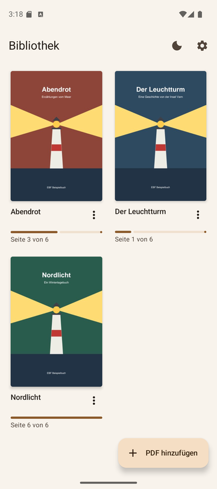
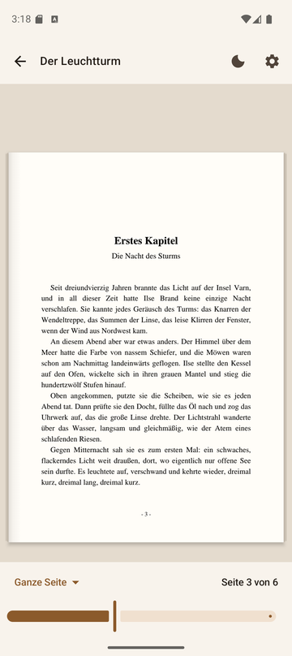
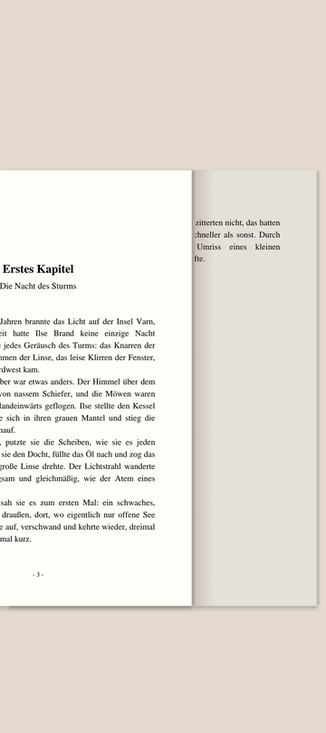
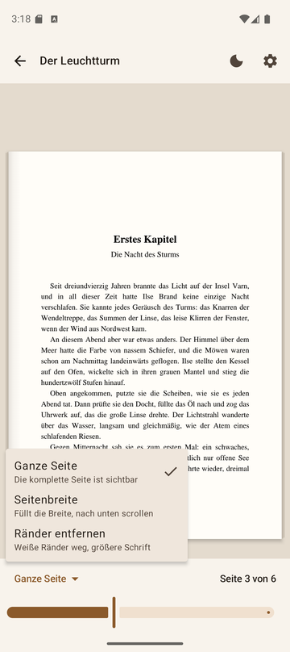
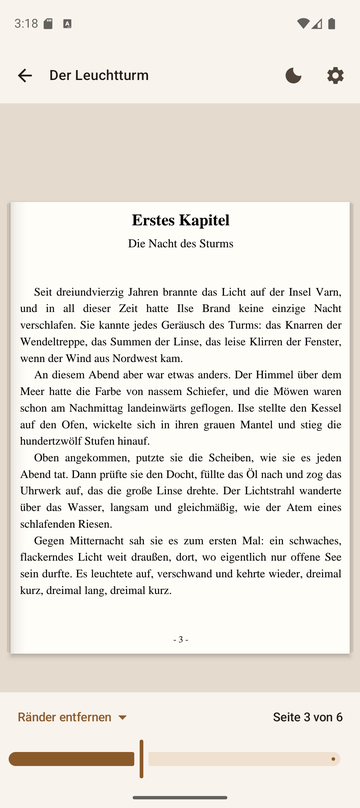

# EBF – E-Book-Reader für PDFs

EBF ist eine Android-App, mit der du PDFs wie ein Buch liest: Seite für Seite horizontal blättern, mit Papier-Optik, festen Zoom-Formaten und einem Dark Mode, der auch die Seiten dunkel macht.

| Bibliothek | Lesen | Umblättern |
| :---: | :---: | :---: |
|  |  |  |
| **Zoom-Formate** | **Ränder entfernen** | **Dark Mode** |
|  |  |  |

## Funktionen

- **Bibliothek** mit Cover, Titel und Lesefortschritt. Die App merkt sich die zuletzt gelesene Seite.
- **Horizontales Blättern** per Wischen oder Tippen auf den Bildschirmrand.
- **Buch-Optik**: Die Seite liegt wie Papier auf dem Tisch. Ein Schatten am Bundsteg und Blattkanten links und rechts zeigen, wie weit du im Buch bist.
- **Umblätter-Animation**: Die obere Seite gleitet weg und gibt die nächste frei.
- **Zoom über ein Dropdown** mit festen Formaten statt Pinch-Zoom. Links und rechts wird nie etwas abgeschnitten.
- **Dark Mode** für App und Seiten: helle Schrift auf dunklem Papier. Bilder wie Cover bleiben normal.
- **„Öffnen mit → EBF“** aus dem Dateimanager, den Downloads oder anderen Apps.
- Läuft komplett offline. Keine Berechtigungen, keine Werbung, kein Tracking.

## Installation auf dem Handy

Voraussetzung: Android 8.0 oder neuer.

### Am einfachsten: APK aus GitHub Releases

1. Öffne auf dem Handy den Browser und melde dich bei GitHub an. Das Repo ist privat, deshalb ist die Anmeldung nötig.
2. Rufe **https://github.com/MoFrei98/EBF/releases/latest** auf.
3. Tippe unter **Assets** auf **`EBF-<Version>.apk`**. Der Download startet.
4. Öffne die heruntergeladene Datei, zum Beispiel über die Benachrichtigung oder die App **Dateien → Downloads**.
5. Beim ersten Mal fragt Android, ob der Browser Apps installieren darf. Tippe auf **Einstellungen → Aus dieser Quelle zulassen**, dann zurück und auf **Installieren**.
6. Falls Google Play Protect warnt („Unbekannte App“), tippe auf **Weitere Details → Trotzdem installieren**. Die Warnung kommt, weil die App nicht aus dem Play Store stammt.

EBF erscheint danach mit dem Buch-Symbol in der App-Übersicht.

**Ohne Anmeldung am Handy:** Lade die APK am PC herunter und schicke sie dir per USB-Kabel, Cloud-Speicher oder E-Mail aufs Handy. Öffne sie dort und mach ab Schritt 4 weiter.

### Alternative: direkt aus Android Studio

1. Aktiviere auf dem Handy die Entwickleroptionen: **Einstellungen → Über das Telefon** → siebenmal auf **Build-Nummer** tippen.
2. Schalte unter **Entwickleroptionen** das **USB-Debugging** ein und verbinde das Handy per USB.
3. Öffne das Projekt in Android Studio, wähle oben dein Handy aus und klicke auf **Run ▶**.

### Updates

Installiere die neue APK einfach über die alte. Bibliothek, Lesefortschritt und Einstellungen bleiben erhalten.

## Bedienung

### Bibliothek

| Aktion | So geht's |
| --- | --- |
| PDF hinzufügen | **PDF hinzufügen** antippen und die Datei im Dateidialog auswählen. Das Buch öffnet sich sofort. |
| PDF aus einer anderen App öffnen | Im Dateimanager, in den Downloads oder einem Messenger die PDF antippen und **EBF** wählen. |
| Buch lesen | Auf das Cover tippen. Es geht dort weiter, wo du aufgehört hast. |
| Umbenennen / Entfernen | Auf **⋮** neben dem Titel tippen oder das Cover lange drücken. Beim Entfernen bleibt die PDF-Datei auf dem Gerät erhalten. |

Die zuletzt gelesenen Bücher stehen oben. Öffnest du dieselbe PDF über verschiedene Wege, landet sie trotzdem nur einmal in der Bibliothek.

### Lesen

| Geste | Wirkung |
| --- | --- |
| Nach links / rechts wischen | Eine Seite vor / zurück |
| Rechtes Viertel des Bildschirms antippen | Nächste Seite |
| Linkes Viertel antippen | Vorherige Seite |
| Mitte antippen | Leisten ein- und ausblenden |
| Schieberegler unten | Schnell zu einer Seite springen |
| Nach oben / unten wischen | Scrollen, wenn eine Seite höher als der Bildschirm ist |

Beim Weiterblättern blenden sich die Leisten automatisch aus, damit du im Vollbild liest.

### Zoom

Den Zoom wählst du unten links im Dropdown. Pinch-Zoom gibt es bewusst nicht, und links und rechts wird in keinem Format etwas abgeschnitten.

| Format | Was passiert |
| --- | --- |
| **Ganze Seite** | Die komplette Seite passt auf den Bildschirm. |
| **Seitenbreite** | Die Seite füllt die Breite. Ist sie höher als der Bildschirm, scrollst du nach unten. Praktisch im Querformat. |
| **Ränder entfernen** | Die weißen Ränder werden automatisch abgeschnitten, so wird die Schrift größer. Vom Inhalt fehlt nie etwas, und alle Seiten eines Buchs werden gleich stark vergrößert. |

Das gewählte Format wird pro Buch gespeichert.

### Dark Mode

- Mit dem **Mond-/Sonnen-Symbol** oben rechts schaltest du zwischen hell und dunkel um, in der Bibliothek und im Reader.
- Im Dark Mode werden auch die PDF-Seiten dunkel: helle Schrift auf dunklem Papier. Farben behalten ihren Farbton.
- Seiten, die überwiegend aus Bildern bestehen (z. B. Cover), werden nicht invertiert, sondern nur leicht abgedunkelt.

### Einstellungen (Zahnrad)

| Einstellung | Optionen |
| --- | --- |
| Design | Wie im System, Hell oder Dunkel |
| PDF-Seiten im Dark Mode abdunkeln | An: dunkle Seiten. Aus: Seiten bleiben weiß, nur die App ist dunkel. |
| Blättern | **Umblättern wie im Buch** oder einfaches **Schieben** |

## Für Entwickler

**Technik:** Kotlin, Jetpack Compose (Material 3), Android `PdfRenderer`, DataStore, Navigation Compose. Es gibt keine Abhängigkeiten außerhalb von AndroidX.

### Bauen

Öffne das Projekt in Android Studio. Gradle nutzt JDK 21. In der Kommandozeile:

```bash
./gradlew assembleDebug        # Debug-APK
./gradlew testDebugUnitTest    # Unit-Tests
./gradlew assembleRelease      # Release-APK: app/build/outputs/apk/release/app-release.apk
```

Die Release-APK wird mit dem lokalen Debug-Schlüssel von Android Studio signiert (`~/.android/debug.keystore`). Das reicht für die private Verteilung und hat einen Vorteil: Builds aus Android Studio und aus GitHub Releases lassen sich gegenseitig drüberinstallieren. Baust du auf einem anderen PC, gibt es dort einen anderen Schlüssel. Dann musst du die App einmal deinstallieren, bevor die neue Version installiert werden kann.

### Neue Version veröffentlichen

1. In `app/build.gradle.kts` `versionCode` um 1 erhöhen und `versionName` anpassen.
2. `./gradlew assembleRelease`
3. APK umbenennen und als Release hochladen:

```bash
cp app/build/outputs/apk/release/app-release.apk EBF-1.1.apk
gh release create v1.1 EBF-1.1.apk --title "EBF 1.1" --notes "Was ist neu …"
```

### Projektstruktur

```
app/src/main/java/com/example/ebf/
├── MainActivity.kt          Navigation, "Öffnen mit"
├── EbfApp.kt                Application, Repositories
├── data/                    Bibliothek (Book, LibraryRepository) und Einstellungen
├── pdf/                     PdfDocument (Rendering), Crop (Ränder erkennen)
└── ui/
    ├── library/             Bibliothek
    ├── reader/              Reader, Seite, Papier-Optik, Dark-Mode-Farbfilter
    ├── settings/            Einstellungsdialog, Dark-Mode-Umschalter
    └── theme/               Farben und Theme
```
