<p align="center">
  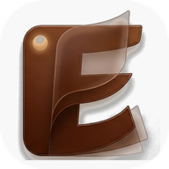
</p>

<h1 align="center">EBF – a book-style PDF reader for Android and iPhone</h1>

<p align="center">
  Read PDFs like a book: turn real-looking pages, sort your books into folders, find them again with search and filters, make the text as large as you need, read at night in dark mode – fully offline.
</p>

> [!WARNING]
> **This project is vibe coded.** The apps, their code, tests, issues and this README were written almost entirely by an AI assistant (Claude) from short prompts, with only light human review. They work for their author's own use, but they have not been audited, tested on many devices or hardened for production. Use them at your own risk, keep backups of your PDFs, and read the code before relying on it.

### Android

| Library with folders | Reading | 3D page turn |
| :---: | :---: | :---: |
| 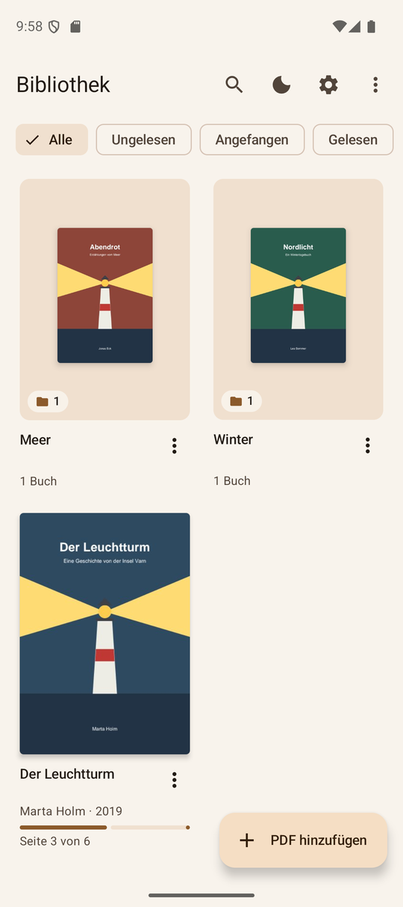 | 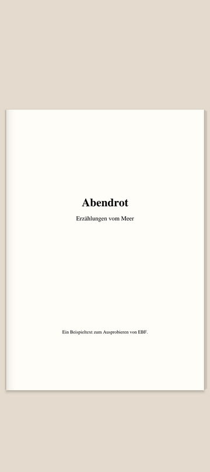 | 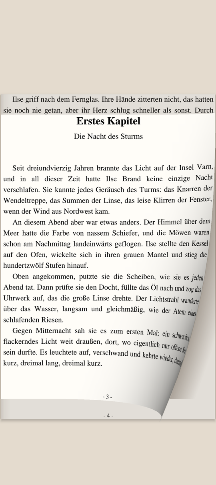 |
| **Text size Groß** | **Dark mode** | **Settings** |
| 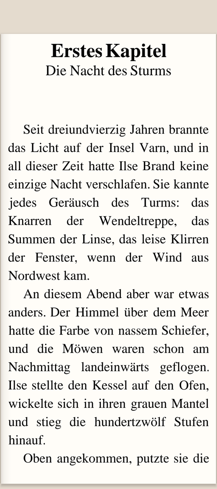 | 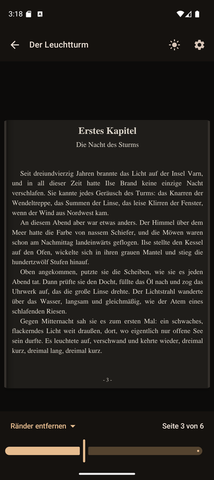 | 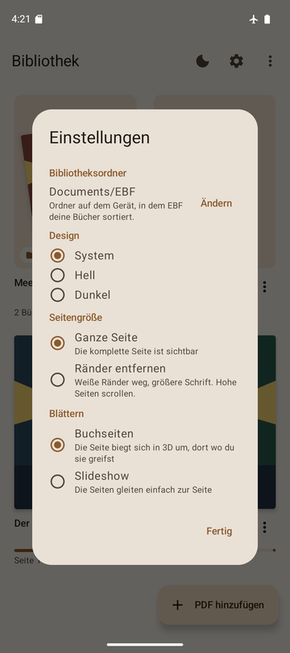 |

### iPhone

| Library | Reading | Text size Groß | Dark mode |
| :---: | :---: | :---: | :---: |
| 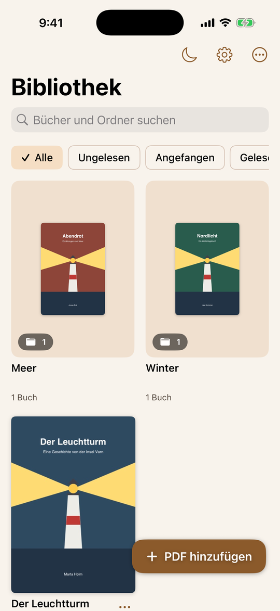 | 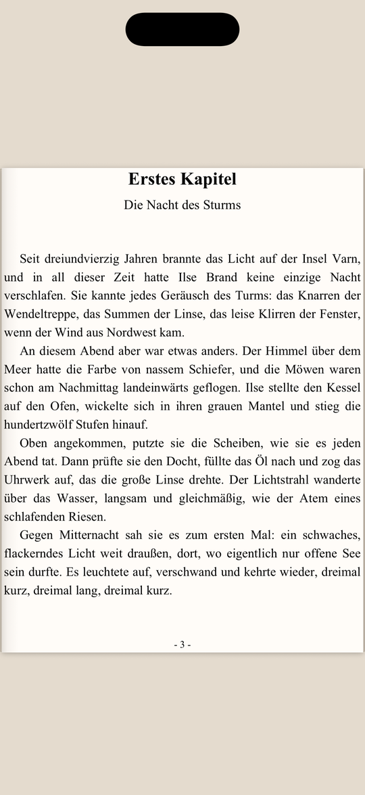 | 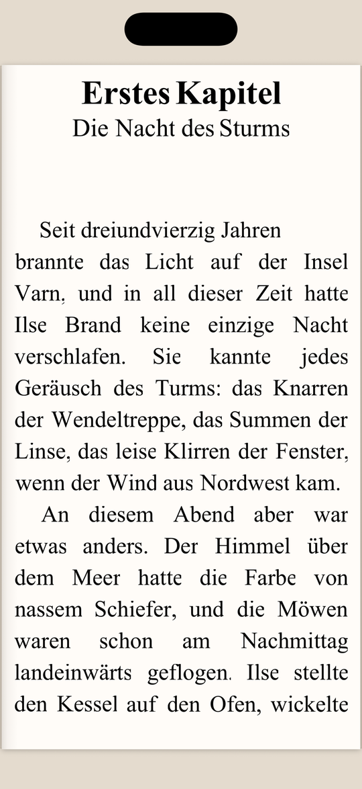 | 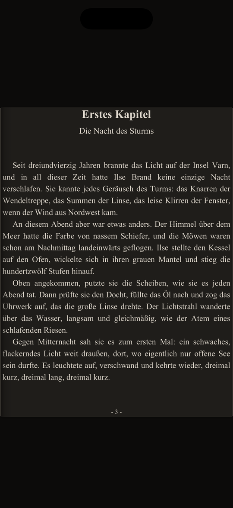 |

The apps' interface is in German. The screenshots use sample books made for this project ([`shared/samples`](shared/samples)); their texts, authors and covers are invented.

## Features

Both apps do the same; where they differ, it says so.

- **Library with real folders.** EBF mirrors a folder on your device: subfolders become folders in the app, PDFs inside appear automatically, and sorting a book into a folder moves the file. Folder tiles show the covers of the books inside. On Android you pick the folder (for example `Documents/EBF`); on the iPhone it is **On My iPhone › EBF** in the Files app, or any folder you choose, for example in iCloud Drive.
- **Book details.** Every book has a title, author and publication year. EBF fills them in automatically from the PDF's metadata or the file name (e.g. `[Lastname_Firstname]_Title.pdf`), and you can edit them.
- **Search and filters.** Search all folders by title, author, year or file name (case, umlauts and accents don't matter) and filter by *unread*, *started* or *finished*.
- **Book pages.** Pages turn like paper, with an optional paper-rustle sound. The page bends from where you grab it. Prefer something simpler? Switch to **Slideshow**.
- **Paper look.** Each page lies on the table like a sheet of paper, with a soft shadow, shading at the spine and stacked page edges that show how far you are in the book.
- **Text as large as you need – without losing any.** Three text sizes; nothing on the left or right is ever cut off:
  - **Klein** shows the whole page.
  - **Normal** (the default) trims the white margins so the text fills the width.
  - **Groß** reflows the text like an e-book: EBF finds the lines and words on each page and sets them again in much larger, shorter lines, keeping the book's font, italics and pictures. Words split by a hyphen at the end of a line are joined again, and chapters start on a new page. One PDF page then spans several screen pages and the page count adapts. This works without a text layer, so scanned books work too.
- **Dark mode for app and pages.** Pages are shown as light text on dark paper. Colors keep their hue and picture pages such as covers are only dimmed, not inverted.
- **Remembers where you are.** Every book reopens where you left it, also when you switch the text size.
- **Open PDFs from other apps:** "Open with → EBF" on Android, "Share → EBF" on the iPhone.
- **Fully offline.** See [Privacy](#privacy-and-offline-use).

| Normal | Groß |
| :---: | :---: |
| 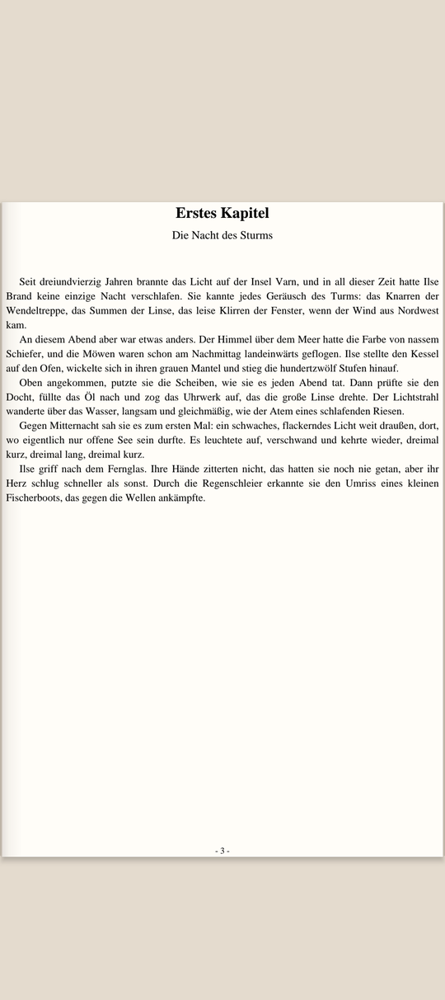 |  |

*The same A4 page at **Normal** and at **Groß**.*

## Install on Android

You need Android 8.0 or newer.

### Easiest: APK from GitHub Releases

1. On your phone, open a browser and sign in to GitHub. The repository is private, so you need to be signed in.
2. Go to **https://github.com/MoFrei98/EBF/releases/latest**.
3. Under **Assets**, tap **`EBF-<version>.apk`** to download it.
4. Open the downloaded file, for example from the download notification or **Files → Downloads**.
5. The first time, Android asks whether your browser may install apps. Tap **Settings → Allow from this source**, go back and tap **Install**.
6. If Google Play Protect warns about an unknown app, tap **More details → Install anyway**. The warning appears because the app does not come from the Play Store.

**Without signing in on the phone:** download the APK on your computer and copy it to the phone with a USB cable (it shows up as a drive in Windows Explorer), then open it on the phone and continue with step 4.

### Alternative: straight from Android Studio

1. Enable developer options on the phone: **Settings → About phone** → tap **Build number** seven times.
2. Turn on **USB debugging** in the developer options and connect the phone via USB.
3. Open the project in Android Studio, select your phone at the top and click **Run ▶**.

### Updating

Install the new APK over the old one. Your library, reading progress and settings are kept.

## Install on the iPhone

You need iOS 17 or newer. EBF is not in the App Store, so you install it yourself with your Apple ID. Apps installed this way with a free Apple ID run for 7 days and then have to be installed again (your library and progress stay); with a paid Apple Developer account they run for a year.

### Get the app file

On your computer, sign in to GitHub and open **https://github.com/MoFrei98/EBF/releases**. Pick the newest release named **EBF for iPhone** and download **`EBF-ios-<version>.ipa`** under **Assets**. The file is not signed – the tools below sign it with your Apple ID.

**Newest build:** GitHub also builds the iPhone app after every change (workflow **iOS** under **Actions**). Open the latest successful run and download the artifact **EBF-ipa**; it contains `EBF.ipa`.

### From Windows: Sideloadly or AltStore

1. Install [Sideloadly](https://sideloadly.io) (or [AltStore](https://altstore.io)) and follow its setup instructions; it needs Apple's iTunes and iCloud for Windows from Apple's website.
2. Connect the iPhone with a USB cable and trust the computer.
3. Drag `EBF.ipa` into Sideloadly, enter your Apple ID and click **Start**.
4. On the iPhone, turn on **Settings → Privacy & Security → Developer Mode** if iOS asks for it, and allow the app under **Settings → General → VPN & Device Management**.

### From a Mac: Xcode

1. Install Xcode from the App Store and [XcodeGen](https://github.com/yonaskolb/XcodeGen) (`brew install xcodegen`).
2. In the `ios` folder run `xcodegen`, then open `EBF.xcodeproj`.
3. Select your iPhone at the top, choose your Apple ID under **Signing & Capabilities** and click **Run ▶**.

## How to use it

### First start

**Android:** on the empty library screen tap **Bibliotheksordner wählen** (choose library folder). The system folder picker opens in `Documents`. Tap the folder icon at the top to create a folder such as `EBF`, open it, tap **Use this folder** and allow access. Everything already in that folder shows up in the app. You can skip this and just add PDFs; folders become available once a library folder is set.

**iPhone:** nothing to set up. Your library is the folder **On My iPhone › EBF** in the Files app; PDFs and folders you put there show up in EBF. You can choose another folder in the settings.

In both apps you can put PDFs and subfolders into the library folder later, for example from your computer; pull down on the library to refresh.

### Library

| Action | How |
| --- | --- |
| Add a PDF | Tap **PDF hinzufügen** and pick a file. It lands in the folder you have open and the book opens right away. |
| Open a PDF from another app | Android: tap the PDF in your file manager, downloads or a messenger and choose **EBF**. iPhone: **Share → EBF**. |
| Create a folder | **⋮** (iPhone: **⋯**) at the top right → **Neuer Ordner** |
| Sort a book into a folder | **⋮** next to the book (or long-press its cover) → **In Ordner verschieben**. You can also create a new folder from there. |
| Rename or delete a folder | Android: **⋮** next to the folder. iPhone: long-press the folder. Only empty folders can be deleted, so nothing gets lost by accident. |
| Navigate | Tap a folder to open it; the back arrow or back gesture goes up one level. |
| Edit book details | **⋮** next to the book → **Details bearbeiten**: title, author's first and last name, publication year. The dialog also shows the page count and where the file is stored. Your edits are never overwritten automatically. |
| Search | Tap the magnifier (iPhone: the search field below the title) and type a title, author, year or file name. Results come from all folders and show which folder they are in. |
| Filter | Tap a chip below the toolbar: *Alle* (all), *Ungelesen* (unread), *Angefangen* (started), *Gelesen* (finished). The filter is remembered; tap *Alle* to turn it off. |
| Sort | **⋮** → *Zuletzt gelesen* (recently read) or *Titel A–Z* |
| Refresh | Pull down, or **⋮** → **Aktualisieren** |
| Remove / delete a book | **⋮** next to the book. Books inside the library folder are deleted from the device after a confirmation. On Android, books outside the library folder are only removed from the app. |

**About moving files:** when you sort a book into a folder, EBF *moves* the PDF within the library folder. On Android, if the system doesn't allow deleting the original (for example for some files opened from other apps), EBF copies it instead and tells you. On the iPhone, PDFs from other apps are always copied into the library.

### Reading

| Gesture | Effect |
| --- | --- |
| Swipe left / right | Next / previous page |
| Tap the right quarter of the screen | Next page |
| Tap the left quarter | Previous page |
| Tap the middle | Show or hide the toolbars |
| Slider at the bottom | Jump to any page |
| Swipe up / down | Scroll when a page is taller than the screen |

The toolbars hide automatically when you turn a page, so you read in full screen. The sun/moon button at the top switches between light and dark mode.

### Settings (gear icon)

| Setting | Options |
| --- | --- |
| Library folder | The folder that EBF mirrors. Tap **Ändern** (iPhone: **Anderen Ordner wählen**) to choose another one. |
| Design | **System**, **Hell** (light) or **Dunkel** (dark). In dark mode the pages are always darkened. |
| Text size | **Klein** (small, whole page), **Normal** (margins fully trimmed, text fills the width; default) or **Groß** (text reflowed in much larger print, more pages). The first time you open a book in **Groß** it takes a few seconds to prepare; after that it opens right away. Text is never cut off. |
| Page-turn sound | Soft paper rustle when you turn a page. Off by default; silent when the phone is on silent or vibrate. |
| Page turning | **Buchseiten** (book pages) or **Slideshow** (pages simply slide) |

## Privacy and offline use

EBF works completely offline and never sends data anywhere:

- **Android:** the app has **no internet permission**, so Android won't let it open any network connection. It requests no storage permission and only accesses the PDFs you pick and the library folder you choose, through Android's system file pickers. Android's automatic cloud backup is turned off for the app.
- **iPhone:** the app contains no network code. It only accesses its own folder (On My iPhone › EBF) and folders you choose yourself. Covers and the prepared large-text data are excluded from backups; your PDFs are normal files in your library folder and are backed up like other files on your iPhone.
- Neither app contains analytics, ads, crash reporting or other third-party services.
- Your library (titles, authors, reading progress, folders) is kept in a local SQLite database in the app's private storage. SQLite is built into Android and iOS, so there's nothing extra to install. The PDFs themselves stay as normal files in your library folder, they are not copied into the database.

The Android app was checked against the release APK and tested in airplane mode.

## Sounds

The page-turn sounds are synthesized by [`tools/make_page_sounds.py`](tools/make_page_sounds.py) – filtered noise, crackle and a soft thump – and belong to this project. No third-party recordings are used, so there are no license restrictions. Both apps use the same sound files.

### Project layout

```
app/src/main/java/com/example/ebf/      Android app (Kotlin, Jetpack Compose)
├── MainActivity.kt          navigation, "Open with", folder picker
├── EbfApp.kt                application, repositories
├── data/                    SQLite database (BookDatabase), library and folder sync (LibraryRepository,
│                            LibraryTree), metadata detection (BookMetadata), settings
├── pdf/                     PdfDocument (rendering), Crop (margin detection)
├── reflow/                  text size Groß: page analysis, line breaking, cache
└── ui/
    ├── library/             library, folder tiles, dialogs
    ├── reader/              reader, page view, paper look, 3D page curl, dark mode filter
    ├── settings/            settings dialog, theme toggle
    └── theme/               colors and theme
ios/                                    iPhone app (Swift, SwiftUI)
├── project.yml              Xcode project, generated with XcodeGen
├── EBFCore/                 shared logic as a Swift package: metadata, search, folders, margins,
│                            colors and the Groß reflow – same rules as the Android app, tested on Linux
└── EBF/                     app: library, reader (UIPageViewController), PDF rendering (PDFKit)
shared/
├── fixtures/                test cases checked by both apps (file names, authors, search)
└── samples/                 sample books for screenshots and tests
tools/                       sound and sample book generators
```
